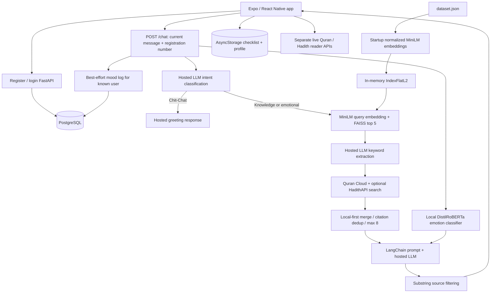

# Hidayah: complete project description and ML evidence audit

Audit date: 5 November 2026, Asia/Karachi. Project version: 1.0.0.

**Current status after repairs, 5 November 2026:** chat generation uses Groq `openai/gpt-oss-120b`. Subsequent behavioral repairs restrict RAG bypass to complete greetings, rewrite search queries and render canonical source quotations. The original audit below records the pre-repair commit and failures; those historical findings are preserved. See sections 18–19 for changes and HTTP evidence.

Repository: [sourceHarris/islamAi](https://github.com/sourceHarris/islamAi).
Inspected local commit and remote HEAD: `07b59996c1ddc47f97f8d387619a6fa62999e13b`.
Commit subject: “Expand dataset to 18k+ records, implement language auto-detection, and enrich chatbot UI rendering”.

The local tracked checkout was clean before this audit, and its commit matched `git ls-remote https://github.com/sourceHarris/islamAi.git HEAD`. No pull, reset, dependency upgrade or application-code change was necessary. The local origin uses the older `d3xture/islamAi` SSH URL; the comparison above used the URL provided for this audit. New documentation and diagnostic scripts were added by this audit. Their results must not be described as historical experiments performed during original development.

## 1. Executive description for a degree report

Hidayah is a cross-platform Islamic spiritual wellness application with an emotion-aware, retrieval-augmented question-answering backend. The React Native/Expo frontend combines Islamic question answering, Quran and Hadith reading, daily spiritual checklists, local habit analytics, a dhikr counter, personal dua editing and swipeable inspirational cards. The Python/FastAPI backend embeds a local religious-text corpus using a pretrained Sentence Transformer, retrieves candidate passages using FAISS, enriches the context through external text-search services, and uses a hosted language model to generate structured answers with citations. A pretrained emotion classifier adjusts the conversational tone. PostgreSQL and SQLAlchemy provide user accounts, interaction logging and a broader seven-table spiritual-tracking schema.

The engineering contribution is the integration and orchestration of retrieval, classification, prompts, source tracking, application state and data persistence. The repository does not demonstrate training a new foundation model, fine-tuning the embedding model, or training its emotion classifier. It also does not contain a pre-existing held-out evaluation establishing answer accuracy, emotion F1 or retrieval relevance. These distinctions matter when describing the work academically.

This audit verified **18,265 retrieval records**, including **11,969 Hadith records** and **6,275 Quran-labelled records**, and measured warm local retrieval at **6.42 ms median / 9.40 ms p95** over 36 serial calls. The web app compiled and backend health passed, but all three audit chat-generation attempts failed with HTTP 502 because the configured Groq model returned `model_not_found`. Corpus size and retrieval speed are not evidence of answer correctness.

## 2. What the project actually implements

| Area | Implementation | Important boundary |
|---|---|---|
| AI chat | FastAPI `/chat`, emotion prediction, intent classification, local retrieval, external search, hosted generation, source display | Single-turn backend; previous messages displayed in the UI are not sent as conversation history |
| Accounts | Email/password registration and login, PostgreSQL user row, local profile session | Local session presence is a navigation gate, not authenticated API authorization |
| Quran reader | Live surah list, Arabic verses and Urdu Jalandhry translation, search and reading views | Reader data is fetched separately from the local English retrieval corpus |
| Hadith reader | Live book list, 20-item pages, number lookup and current-page Arabic search | Does not search all book text semantically; service also supplies Indonesian text |
| Checklist | Five prayers, reading/listening/minutes, dhikr, custom practices and reflection | Screen saves to AsyncStorage; does not invoke `/sync_checklist` |
| Habit analytics | Prayer and Quran streaks, recorded-day insights, 30-day heatmap and prayer completion charts | Derived locally from manually entered checklists, not ML predictions |
| Dhikr | Tap counter, reset, target progress, threshold achievements | Component state; no persistence or milestone API integration |
| Personal duas | Seed entries and create/edit/delete UI | Component state; the PostgreSQL private-dua table is not connected to this screen |
| Swipe cards | Eight predefined cards, gesture navigation, Reanimated transitions | Static content, not personalized ML recommendations |
| Qibla | Geographic bearing formula toward Kaaba coordinates | Hardcoded New York location, heading stays at its initial value; calibration is a timed alert |
| Theme | Dark/light color context, platform status/navigation bar styling | Defaults to dark; theme choice is not persisted |
| Home/profile | Animated home and locally loaded account profile | Home name and prayer progress are hardcoded; some profile statistics and controls are presentation placeholders |

The scope is a working application prototype with a substantive AI backend and partially connected supporting features. Labels such as “production-ready” in comments are not evidence of production security, deployment or tested reliability.

## 3. Architecture and data flow



At backend startup, database tables are created if missing, the entire JSON corpus is embedded, an in-memory FAISS index is built, and the emotion model is loaded. Startup must finish before requests can be served. There is no persisted FAISS index, embedding cache, background indexing or incremental update pipeline in the application code. Each process rebuilds its own index.

## 4. Technology inventory

### Frontend

The application uses TypeScript (`~5.9.2` declared), React (`19.1.0`), React Native (`0.81.4`), Expo (`^54.0.12`) and Expo Router (`~6.0.10`). These are declared dependency versions/ranges; the lockfile and installed packages determine the concrete runtime versions.

| Technology | Purpose in this repository |
|---|---|
| Expo Router / React Navigation | File-based screens, root stack and five bottom tabs |
| React hooks and context | Screen state, lifecycle, theme management |
| AsyncStorage 2.2.0 | Stored user profile and date-keyed spiritual checklist history |
| Reanimated ~4.1.1 | Scroll-linked transforms, particles, transitions, swipe-card movement |
| Gesture Handler ~2.28.0 | Gesture root and swipe-card pan gestures |
| React Native SVG 15.12.1 | Decorative patterns and vector progress graphics |
| Expo Blur / Linear Gradient | Card surfaces, gradients and visual styling |
| Lucide React Native | Navigation and action icons |
| Safe Area Context / Screens | Insets and navigation integration |
| React Native Web / React DOM | Browser execution of the Expo application |
| Expo Navigation Bar / Status Bar | Android system bars and screen appearance |
| Fetch API | HTTP communication with FastAPI and external reader services |

Other declared dependencies include Expo Camera, Location, Sensors, Haptics, Linking, Font, Splash Screen, Constants, Symbols, System UI and Web Browser; vector icons; `@lucide/lab`; deck swiper; WebView; URL polyfill; worklets/worklets-core; and Babel/React typings. A package being installed does not prove a feature uses it. In particular, camera-based inference, live GPS Qibla and magnetometer heading were not implemented in the inspected code. The complete dependency declaration remains in `package.json`; exact transitive versions are in `package-lock.json`.

### Backend

| Technology | Verified use | Installed version during audit |
|---|---|---|
| Python | Backend and ingestion scripts | 3.14.3 in existing `venv` |
| FastAPI | REST API, validation integration, OpenAPI | 0.136.0 |
| Uvicorn | ASGI server | 0.44.0 |
| Pydantic | Request/response schemas, email and length validation | 2.13.2 |
| SQLAlchemy | ORM models, relationships, sessions, transactions | 2.0.49 |
| psycopg2-binary | PostgreSQL driver | 2.9.11 |
| python-dotenv | Environment configuration | 1.2.2 |
| Sentence Transformers | Local corpus/query embedding | 5.4.1 |
| Transformers | Local text-emotion classification pipeline | 5.5.4 |
| PyTorch | Local neural model inference | 2.11.0 |
| FAISS CPU | Exact dense-vector nearest-neighbour search | 1.13.2 |
| NumPy | Float32 embedding arrays | 2.4.4 |
| LangChain Core | Prompt templates, runnable composition, string parser | 1.4.0 |
| langchain-groq | Primary hosted LLM integration | 1.1.2 |
| langchain-google-genai | Alternative hosted LLM integration | 4.2.4 |
| Requests | External source search and ingestion | 2.33.1 |

`backend/requirements.txt` lists unpinned package names. It includes `langchain`, `google-generativeai` and `huggingface-hub` as well. The active code imports `google.genai.types`, supplied by the newer `google-genai` distribution installed in this environment. Requests and the newer Google SDK are not explicitly declared there. Transitive installation happened to supply them here; this is a reproducibility limitation. Installed OpenAI, bcrypt, passlib or Alembic packages are not proof those systems are used by the active application. The runtime snapshot is [backend-installed-packages.txt](evidence/backend-installed-packages.txt).

## 5. Dataset: exact size, identity and composition

The file `backend/dataset.json` is a **retrieval knowledge corpus**, not a supervised training or labeled evaluation dataset. Every record has `id`, `source`, `citation` and `text`. The backend embeds only `text`; citations and sources remain parallel metadata.

| Source label | Records |
|---|---:|
| Quran | 6,275 |
| Hadith | 11,969 |
| Hisnul Muslim | 17 |
| Fiqh us-Sunnah | 4 |
| **Total** | **18,265** |

| Hadith citation collection prefix | Records |
|---|---:|
| Sahih al-Bukhari | 3,087 |
| Sahih Muslim | 2,921 |
| Jami at-Tirmidhi | 1,951 |
| Sunan Abi Dawud | 2,006 |
| Sunan Ibn Majah | 2,001 |
| Sunan an-Nasa'i | 3 |

Counts are computed from the checked-out file, not inferred from the seeder's target limits. Legacy records explain why several totals exceed an individual seeding run's cap. Collection membership alone does not establish that every included narration has a verified authenticity grading; the normalized schema does not retain grading metadata.

The local file has **8,178,085 bytes**, SHA-256 `505170f233ee5e49c202f65182bce1409b5a3ce5b7628d8cfa59ab4d2dd1a5a4`. File bytes and hashes can differ across Git line-ending conversion without changing parsed records; the remote directory listing reports 8,068,494 bytes. Use the saved local hash to identify these exact audit measurements.

| Corpus integrity diagnostic | Result |
|---|---:|
| Missing/empty required fields | 0 |
| Duplicate IDs beyond the first occurrence | 0 |
| Repeated exact text strings beyond the first occurrence | 241 |
| Repeated exact citation strings beyond the first occurrence | 11 |
| Distinct Quran chapter:verse coordinates parsed from citations | 6,223 |
| Quran-labelled citations without parseable coordinates | 0 |
| Minimum / median / p95 / maximum words per record | 3 / 38 / 164 / 2,896 |

The 241 repeated texts imply 18,024 distinct exact strings. This is not a semantic deduplication count. Similarly, 6,275 Quran-labelled records are **not 6,275 unique Quran verses**. They map to 6,223 distinct citation coordinates, with overlapping variants/legacy records. A full canonical verse-by-verse completeness audit is still needed; the seeder deliberately skips short verses. Do not claim the indexed corpus contains all 6,236 canonical verses without qualification.

Evidence and rerun: [dataset-audit.json](evidence/dataset-audit.json), `node scripts/audit-dataset.cjs`.

### Provenance and preprocessing

`backend/seed_full_dataset.py` describes these ingestion sources:

1. Quran translations through the [fawazahmed0 Quran API repository](https://github.com/fawazahmed0/quran-api), fetched through jsDelivr. It tries `eng-sahihinter`, then `eng-islamiccenterofamerica`, then `eng-maududi`. The selected fallback edition is not stored in each normalized record, so the exact translator of every historical entry is not established by its `source` label.
2. English Hadith through the [fawazahmed0 Hadith API repository](https://github.com/fawazahmed0/hadith-api): Bukhari, Muslim, Tirmidhi, Abu Dawud and Ibn Majah editions. The main routine examines at most the first 3,000, 3,000, 2,000, 2,000 and 2,000 raw entries respectively, then filters them. These are partial collection imports.
3. Hisnul Muslim through `wafaaelmaandy/Hisn-Muslim-Json` on jsDelivr, with an embedded list of 14 duas if the fetch/parse yields no usable records.
4. `append_dataset.py` contains eight curated additions: four Hisnul Muslim records and four Fiqh us-Sunnah records. Existing dataset content is preserved; these scripts alone do not establish provenance for every legacy record.

The seeder uses HTTP retries (three attempts, exponential delays), strips text, skips Quran entries with fewer than three whitespace-delimited words, skips Hadith with fewer than eight words, collapses Hadith whitespace, and inserts a PBUH annotation at the first matching “the Prophet”. It generates source-specific IDs and human-readable citations and merges by ID. It does **not** globally deduplicate text, validate religious claims, preserve full upstream metadata, compute licenses or create a labeled train/test split. Re-running the same IDs preserves existing entries rather than updating their text. `append_dataset.py` uses a working-directory-relative path; run it from `backend` if using it.

There is no separate passage chunker: each JSON record is treated as one retrieval unit. The loaded embedding model reported a **256-token sequence limit**. Long Hadith can therefore be truncated by the embedding model while their full text still enters the generation context. Word counts above are whitespace counts, not tokenizer lengths. Translation, authenticity, edition/version and licensing need explicit provenance review before publishing a scholarly dataset. No repository license was identified in the inspected root listing.

## 6. ML and NLP techniques, precisely

### 6.1 Dense semantic embeddings

The application loads `sentence-transformers/all-MiniLM-L6-v2` as a pretrained encoder. Its output is a 384-dimensional vector. Corpus and query embeddings are L2-normalized and converted to NumPy float32. This supports matching related meaning rather than only identical words. The [upstream model card](https://huggingface.co/sentence-transformers/all-MiniLM-L6-v2) describes the pretrained model; its training results are not measurements of Hidayah.

There is no project-specific contrastive training, fine-tuning, tokenizer modification, learned reranker or embedding evaluation in the original source. A retrieval corpus supplies documents; it does not update model weights.

### 6.2 FAISS exact retrieval and thresholding

`faiss.IndexFlatL2` stores every vector and performs exhaustive nearest-neighbour comparison. It is exact search in this embedding space, not an approximate HNSW/IVF index. The chat path requests five neighbours and accepts only distances strictly below 1.0. Accepted records retain their original index order. An empty/missing index returns no context.

FAISS returns **squared Euclidean distance** for this metric. For unit-normalized vectors, `squared_L2 = 2 - 2 * cosine_similarity`, with theoretical range 0 to 4. Therefore the code's strict `distance < 1.0` gate corresponds to cosine similarity greater than 0.5, aside from numerical effects. Comments describing this as ordinary L2 distance in a 0–2 range are inaccurate. See [FAISS metric documentation](https://github.com/facebookresearch/faiss/wiki/MetricType-and-distances).

The distance is not a probability, calibrated confidence, relevance label or answer-accuracy score. The threshold was configured in code; no validation curve demonstrating it is optimal was found. Exact nearest-neighbour search does not guarantee the nearest document is relevant.

At 18,265 vectors × 384 coordinates × 4 bytes, the raw vector payload is 28,055,040 bytes, about 26.76 MiB. This is a calculation, not measured process memory: model weights, metadata, Python objects and working arrays add overhead. Flat search is O(Nd) per query; increasing corpus size and worker count increases cost and memory requirements.

### 6.3 Emotion classification

The project loads `j-hartmann/emotion-english-distilroberta-base` through the Hugging Face text-classification pipeline, top prediction only, CPU (`device=-1`). Application label mapping is:

| Model class | Application label |
|---|---|
| anger | angry |
| disgust | disgusted |
| fear | anxious |
| joy | joyful |
| neutral | neutral |
| sadness | sad |
| surprise | surprised |

Only the first **512 characters**, not 512 tokens, are passed to the pipeline. Failures return `neutral`; confidence is not returned to the frontend or stored by the chat response. This conflates neutral predictions and inference errors. The label is injected into the answer prompt; it does not change the local retrieval query or select an emotion-specific index.

The model was trained upstream on six datasets and predicts seven classes, according to its [model card](https://huggingface.co/j-hartmann/emotion-english-distilroberta-base). Those datasets belong to the pretrained model's provenance; Hidayah does not train on them in this repository. English emotion classification is not evidence of validated Urdu/Arabic emotion recognition or clinical diagnosis.

### 6.4 Intent routing and keyword extraction

A hosted LLM classifies the current message into `Chit-Chat`, `Emotional` or `Fiqh/Knowledge`. The output is a plain string, not a constrained enum response. Classification failure defaults to knowledge retrieval. A matching chit-chat string bypasses retrieval and uses a short greeting prompt. All other outputs follow the knowledge/emotional path.

For that path, another LLM call extracts a central English keyword. Alphanumeric characters and spaces are retained. The code does not strictly enforce exactly one word. This keyword supports external lexical search; the local embedding query remains the user's original message.

### 6.5 Multi-source retrieval

Local FAISS retrieval is enriched with:

- Al-Quran Cloud `search/{keyword}/all/en.sahih`: at most four returned verses; five-second HTTP timeout per attempt. Multiword output can trigger full-phrase, first-word and last-word attempts.
- Optional HadithAPI.com `hadiths` search: at most three entries, five-second timeout, only when `HADITH_API_KEY` exists.

Local candidates come first, followed by remote candidates. The merge removes exact lowercased/trimmed citation duplicates and keeps at most eight records. It does not use BM25, reciprocal-rank fusion, cross-encoder reranking, remote semantic scores or a common confidence scale. Calling this hybrid local-dense plus external-keyword retrieval is accurate; calling it a trained hybrid ranker is not.

### 6.6 Generation and prompt controls

`ChatPromptTemplate | LLM | StrOutputParser` constructs the LangChain runnable. Provider choice is:

1. If `GROQ_API_KEY` is present: `llama-3.3-70b-versatile`, temperature 0.0, maximum 1,500 output tokens.
2. Otherwise, if the Google key passes a basic length check: `gemini-1.5-flash`, temperature 0.0, maximum 1,500 output tokens, configured top-p/top-k and four `BLOCK_NONE` harm categories.
3. Otherwise fail with missing-configuration errors.

This is configuration-based provider selection, **not automatic failover after a Groq request fails**. A successful provider call is required to establish that a configured model name is currently available. Old OpenAI comments and the frontend's legacy `llama-3.1-8b-instant` constant do not describe the active backend model.

The knowledge prompt requests a direct answer, verbatim cited evidence, practical application, and language-sensitive output, including an Urdu summary for English/Urdu input. It requests compassionate openings for selected emotions and refusal when specific evidence is absent. It forbids invented references, roleplay and personalized rulings. These are prompt instructions, not measured guarantees. Temperature zero does not prove deterministic or hallucination-free behavior.

No-context queries still reach the generator with a “No relevant context” string. The application does not deterministically refuse before generation. Chit-chat uses a different, shorter system prompt. Testing both routes matters.

### 6.7 Citation display and interaction logging

After generation, retrieved citations are included in the API's `sources` only if their exact lowercased citation string appears somewhere in the lowercased reply. This reduces unrelated source display but is not full citation validation. It does not check entailment, quote fidelity, religious authenticity or invented extra citations. Formatting changes can omit a used source; merely mentioning a citation can include an unsupported one.

For a known registration number, a mood log records the predicted emotion, up to 500 characters of input, and the first retrieved citation. That citation is not necessarily the one ultimately quoted. Logging failure is non-fatal and rolls back its transaction. Anonymous messages do not create a mood row.

## 7. API contract

| Method/path | Main input | Main output | Behavior |
|---|---|---|---|
| `GET /` | None | status, app, version, faiss_docs | Basic process/index health |
| `POST /register` | name, email, password; optional registration_number/class_name | id, registration_number, name, class_name, email, message | Creates account; HTTP 201 |
| `POST /login` | email, password | Same profile schema | Invalid login returns HTTP 401 |
| `POST /chat` | message, optional user_id defaulting to anonymous | reply, detected_emotion, sources | Full routed pipeline |
| `POST /sync_checklist` | user_email, checklist_date, ten booleans and optional reflection_note | message, checklist_id | Upserts one user's daily checklist |
| `GET /docs`, `/openapi.json` | None | Generated API documentation/schema | Framework-provided documentation |

Chat message validation requires 1–2,000 characters. Registration requires a 2–150-character name, valid email and password of at least four characters. Empty strings are rejected for chat, but whitespace-only input can pass server length validation. The client trims user messages. Chat uses 503 for absent LLM keys and 502 for generation failures. Input-schema failures use FastAPI's 422 response. External-search errors are caught and fall back to the remaining retrieval context.

The current endpoints do not accept or validate a JWT/session bearer token. A caller supplies `user_id` or email; this is not proof of identity. Password verification uses unsalted SHA-256 despite a database-column comment saying bcrypt. This should be described as prototype credential handling, not secure production authentication.

## 8. PostgreSQL schema and storage boundaries

| Table | Key data | Relationships/constraints |
|---|---|---|
| users | id, registration number, name, class, email, password hash, created time | Unique registration/email; parent of other entities |
| mood_logs | user, emotion, timestamp, recommended citation, input snippet | User FK and indexed access |
| spiritual_checklists | user/date, five prayers, read_quran, did_dhikr, sunnah_prayers, charitable_act, mood_logged, reflection | Unique `(user_id, checklist_date)` |
| prayer_streaks | current/longest streak, last prayer date, total logged | One row per user |
| quran_streaks | current/longest streak, last reading date, total sessions | One row per user |
| private_dua_book | title, content, created time, answered flag | User FK |
| milestones | type, title, description, icon, achieved time | Unique `(user_id, milestone_type)` |

SQLAlchemy relationships use cascading delete/orphan behavior. Sessions close through a FastAPI dependency; commits/rollbacks occur in endpoint logic. `create_all` creates missing tables; it is not a schema migration system. Database setup assumes the PostgreSQL database already exists. `setup_db.py --reset` is destructive and was not used in this audit.

Only registration/login, chat mood logging and checklist synchronization have active API handlers. The existence of streak/dua/milestone tables is not evidence the app synchronizes those screens to PostgreSQL. The current checklist UI also does not call its available sync endpoint.

Local data uses `hidayah_user` for the session profile and `@spiritual_tracking_data` for all date-keyed checklist history. The tracking key is not namespaced per account. Logout removes the user profile but does not clear that history; multiple accounts on one device can therefore see shared checklist-derived data. There is no encrypted local vault or demonstrated cross-device sync.

## 9. Habit-tracking algorithms

`services/trackingService.ts` supplies default prayers/dhikr and loads/saves daily checklists. These functions are deterministic application logic, not ML.

- Prayer streak: scans back up to 365 days; counts days with all five non-custom prayers completed. An incomplete/missing current day is tolerated so yesterday's streak remains visible.
- Quran streak: the same scan, with either reading or listening qualifying. Minutes are stored but not used as a minimum streak threshold.
- Weekly insight: selects the latest seven **recorded dates**, which can span more than seven calendar days; prayer denominator is recorded dates × five, with an empty-state fallback of 35.
- Heatmap: examines the last 30 calendar days. Intensity gains one point for any prayer, one for all five, one for Quran reading/listening and one for any completed dhikr: range 0–4.
- Prayer analytics: computes per-prayer completion over up to 30 stored keys. The code slices object insertion order without sorting, so backfilled dates may not represent the latest 30 chronological dates.

Date handling mixes formatted local dates with JavaScript date parsing. Boundary/timezone tests are needed before claiming robust global-date behavior. None of these counters demonstrates improved wellbeing or religious adherence; outcome claims require a separate user study.

## 10. Measurable results: what exists and what is missing

The specific criticism was that a list of ML libraries does not establish a well-evaluated ML pipeline. That criticism is valid for the original repository. No labeled benchmark, held-out split, training log, confusion matrix, retrieval qrels, ablation report, quality score or pre-existing inference-latency report was found in tracked project sources.

| Evidence category | Status |
|---|---|
| Corpus size and composition | Measured in this audit; 18,265 records |
| Corpus structural integrity and duplicates | Measured and saved in dataset-audit.json |
| Local retrieval latency | Audit benchmark script and raw per-query evidence; see runtime addendum below |
| API functional behavior | Audit smoke checks; see runtime addendum below |
| Emotion accuracy / macro-F1 | Not established; requires labeled, representative held-out inputs |
| Intent accuracy / macro-F1 | Not established |
| Retrieval Precision@k / Recall@k / MRR / nDCG | Not established; requires independent relevance judgments |
| Answer correctness / groundedness | Not established; requires a documented rubric and human review |
| Citation precision / quote fidelity | Not established |
| Hallucination or unsupported-claim rate | Not established |
| Multilingual quality | Not established; prompt support is not evaluation |
| Concurrent throughput / production p95 latency | Not established |
| Clinical or wellbeing benefit | Not studied |

### Performance diagnostics added by this audit

`scripts/benchmark_retrieval.py` builds the same local index using application functions, excludes one warmup call, then measures 12 fixed English queries repeated three times: 36 serial retrieval calls. Each timing includes query embedding, FAISS search, threshold filtering and Python result construction. It excludes emotion classification, provider generation, keyword/intent calls, external HTTP, database access and client rendering. It saves each query, citations, accepted count and timing in `docs/evidence/retrieval-benchmark.json`.

This experiment is a **performance diagnostic**, not a semantic-relevance evaluation. Its queries are author-written examples, not a held-out representative dataset. Returning five records is not Recall@5. It was run on an AMD Ryzen 9 7900X CPU with 12 cores/24 logical processors; concurrent startup activity can affect timing. The JSON records Python/PyTorch versions, thread count, dimensions, model sequence limit and percentile definition. The index-build timer includes model loading and corpus embedding, but excludes Python module import. Cold-start and deployment benchmarks require separate experiments.

`scripts/smoke_runtime.py` performs anonymous health/schema checks, invalid empty-message validation, greeting, knowledge and emotional requests. It stores output and per-request HTTP timing in `runtime-smoke.json`. Generated answers are ungraded observations. A 200 response does not establish answer accuracy; a failed external provider does not mean local retrieval failed.

## 11. Evaluation methodology needed for a defensible degree result

The following is a proposed protocol, not a completed experiment or achieved score.

### Define evaluation sets before tuning

Create independently reviewed question sets covering Quran knowledge, Hadith, supplications, practical questions, emotional support, unsupported/out-of-domain questions, adversarial instruction changes and greetings. Include English, Urdu script, Roman Urdu and Arabic if those are claimed supported. Keep a development set for selecting thresholds/prompts and a frozen test set for final reporting. For example, 100 development questions plus 300 test questions is a possible initial design, not a property of the current dataset. Report category/language counts, sampling criteria, annotation instructions and uncertainty.

For emotion/intent classifiers, obtain consented, anonymized text with independently assigned labels, adequate examples per class, and adjudication of disagreements. Avoid taking the model's own prediction as ground truth. Domain adaptation matters because a general English emotion model can behave differently on Islamic counseling language or code-switching.

For retrieval, give each query a set of relevant document IDs and graded relevance judgments. Use canonical citation groups where variants represent the same verse. Pool candidates from multiple methods and have reviewers judge them so a single retriever does not define its own relevance labels. If relevance judgments are incomplete, label the reported recall as recall against the judged pool, not complete corpus recall.

### Report the right metrics

| Component | Metric | Definition / reporting requirement |
|---|---|---|
| Emotion | Accuracy | Correct predictions / all labeled examples; add per-class support |
| Emotion/intent | Macro-F1 | Mean per-class F1; report precision, recall, confusion matrix and failure counts |
| Retrieval | Precision@k | Relevant returned documents / k; define how threshold-shortened results are treated |
| Retrieval | Recall@k | Relevant documents retrieved in top k / all judged relevant documents |
| Retrieval | Hit@k | Fraction of queries with at least one relevant result; distinct from recall |
| Retrieval | MRR | Mean reciprocal rank of the first relevant result; zero if none |
| Retrieval | nDCG@k | Rank-discounted graded relevance normalized to ideal ordering |
| Answers | Human correctness | Predefined 0/1/2 or similar rubric; report agreement and adjudication |
| Answers | Groundedness | Supported factual claims / all factual claims |
| Citations | Citation precision | Correct supporting citations / citations emitted |
| Quotations | Exact-quote fidelity | Quoted spans matching the supplied source under documented normalization |
| Refusal | Precision/recall | Appropriate refusals and false refusals on answerable/unsupported cases |
| Runtime | p50/p95, failures | Per stage and end-to-end; successes and errors reported separately |
| Runtime | Throughput | Successful requests/second at stated concurrency and hardware |

For a class, precision is `TP/(TP+FP)`, recall is `TP/(TP+FN)`, and F1 is `2PR/(P+R)`. Define zero-division handling. Macro-F1 weights classes equally; weighted F1 can conceal weak minority-class performance. A single “accuracy” value is not sufficient for a mixed retrieval-and-generation application. BLEU/ROUGE or token-overlap F1 can be secondary text-similarity diagnostics, but they do not establish theological correctness or citation support.

### Baselines and ablations

Evaluate keyword/BM25 retrieval versus MiniLM/FAISS on the same questions; dense-only versus local-plus-external retrieval; threshold disabled versus tuned threshold; top-k 3/5/8; and, if implementing one, a reranker. Compare generation without retrieval, local RAG and multi-source RAG. Evaluate tone with and without emotion conditioning using blinded reviewers, without presenting empathy ratings as mental-health efficacy.

Tune on development data only. Freeze prompts, provider/model version, corpus hash, embedding revision, index parameters and external response snapshots before testing. External services change independently of the Git commit; save sanitized returned records to reproduce their contribution. Group paraphrases and near-duplicate questions across splits to reduce leakage. The entire retrieval corpus can remain searchable during evaluation; the held-out unit is the independently labeled question/relevance set, not an arbitrary supervised train/test split of religious documents.

### Runtime experiment design

Measure model download, model load, corpus encoding/index build, emotion prediction, intent call, query encoding/search, keyword call, each external API, final generation, database logging and total HTTP request latency separately. Separate cold and warm requests, record prompt/output tokens and provider retries, use monotonic timers, and state sample size, concurrency, CPU/GPU, RAM and software versions. Test greeting and knowledge routes separately: greeting normally needs two hosted calls, while knowledge normally needs three plus external HTTP. Do not publish a warm local search timing as total answer latency.

Use at least repeated runs and sufficiently many requests to characterize tails; compute percentile definitions consistently. Include confidence intervals or bootstrap intervals for quality estimates, failures/timeouts, empty-context rate and costs. A load test should use a test database and synthetic accounts so sensitive real mood text is not exposed or modified.

### Results table to fill after real evaluation

| Experiment | Test n | Accuracy/macro-F1 | P@5 / R@5 / MRR / nDCG@5 | Correctness / citation precision | p50 / p95 HTTP ms |
|---|---:|---|---|---|---|
| Current full pipeline | Not evaluated | Not measured | Not measured | Not measured | See limited smoke observations, not a load benchmark |
| Dense-only baseline | Not evaluated | N/A | Not measured | Not measured | Not measured |
| Lexical baseline | Not evaluated | N/A | Not measured | N/A | Not measured |
| Emotion classifier | Not evaluated | Not measured | N/A | N/A | Not measured separately |

Never replace missing cells with estimated or aspirational numbers. The strongest defensible response to the criticism is reproducible measurements plus a clearly scoped evaluation, not a fabricated percentage.

## 12. Limitations that affect academic claims

1. **Knowledge provenance:** partial Hadith imports, duplicate/overlapping verse entries, missing translator/grading metadata and edited Hadith text limit source-traceability claims.
2. **Context length:** entire records are embedded as units; long entries can lose later content through model truncation, and generation has no explicit input-token budget.
3. **Language mismatch:** English retrieval and emotion models sit behind multilingual generation prompts. Urdu/Arabic output support does not validate multilingual retrieval or classification.
4. **Prompt-only constraints:** no programmatic entailment/quote verifier, scholar verification or measured hallucination control. Some UI language invites rulings while prompts prohibit issuing them.
5. **Latency:** serial hosted calls and external requests contribute network delays. No streaming reply, response cache or persisted index is implemented.
6. **Scaling:** synchronous chat endpoint and per-process model/index state; no distributed vector store, task queue or load-test evidence.
7. **Credentials/authorization:** SHA-256 password hashes, short password minimum, local profile presence and caller-supplied identifiers are prototype mechanisms, not production authentication.
8. **Privacy:** mood logs store input snippets; no retention/deletion policy, encryption-at-rest configuration or consent workflow is demonstrated. AsyncStorage checklist history is shared across local accounts.
9. **Integration:** streak/dua/milestone database models exceed connected API/UI behavior. Qibla sensor behavior and several dashboard elements remain mock/static. Static religious content also needs review: the first swipe card pairs its Arabic string with an English quote/reference that should be independently checked for agreement; hardcoded cards bypass the backend's citation controls.
10. **Reproducibility:** unpinned backend requirements, unpinned model revisions, live external results and stale comments complicate exact replication.

These are project-specific findings, not reasons to erase the substantial implementation. They define what the project demonstrates and what future work should address.

## 13. File-by-file guide

| File | Responsibility |
|---|---|
| `app/_layout.tsx` | Gesture and safe-area providers, theme provider, local session route gate, status/navigation styling, root stack |
| `app/(tabs)/_layout.tsx` | Home, tracker, Quran, chatbot and profile tabs |
| `app/(tabs)/index.tsx` | Animated home, decorative SVG, static greeting/progress and feature shortcuts |
| `app/(tabs)/chatbot.tsx` | Current-message API client, cached registration number, chat bubbles, rich-text/evidence/source/RTL rendering, loading and errors |
| `app/(tabs)/quran.tsx` | Quran/Hadith tabs, live lists, reading mode, search; static recent/bookmark presentation |
| `app/(tabs)/tracker.tsx` | Loads local analytics on focus and renders streak, heatmap and prayer charts |
| `app/(tabs)/profile.tsx` | Stored profile, theme switch, logout and presentation settings/statistics |
| `app/login.tsx` | Backend health indicator, login/register forms, error parsing, local profile save |
| `app/checklist.tsx` | Daily checklist editing, custom practices and reflection saved locally |
| `app/dhikr.tsx` | In-memory counter and thresholds |
| `app/dua.tsx` | In-memory personal dua CRUD |
| `app/qibla.tsx` | Static-location bearing and compass presentation |
| `app/swipecards.tsx` | Eight static cards, pan gestures, spring/timing transitions |
| `app/+not-found.tsx` | Unknown-route UI |
| `components/HadithDetailView.tsx` | Paginated book reading and scoped search |
| `services/quranApi.ts` | Surah metadata and parallel Arabic/Urdu verse HTTP calls |
| `services/hadithApi.ts` | Gading Hadith books and range pagination |
| `services/trackingService.ts` | Checklist storage/defaults, streak and chart algorithms |
| `constants/config.ts` | Platform API_BASE and legacy frontend prompt/model constants |
| `contexts/ThemeContext.tsx` | Dark/light palettes and toggle context |
| `hooks/useFrameworkReady.ts` | Optional browser framework-ready hook |
| `backend/main.py` | Models/index initialization, prompts, retrieval, API routing, account and checklist handlers |
| `backend/database.py` | Seven ORM tables, engine/session setup, create/reset helpers |
| `backend/dataset.json` | Retrieval records and citation/source metadata |
| `backend/seed_full_dataset.py` | Download/filter/merge corpus expansion |
| `backend/append_dataset.py` | Eight curated additions, ID-based merge |
| `backend/setup_db.py` | Create missing schema, optional destructive reset, row-count verification |
| `backend/requirements.txt` | Unpinned Python dependency declaration |
| `package.json` / `package-lock.json` | JS dependency/scripts manifest and resolved lockfile |
| `tsconfig.json` | TypeScript and Expo typing configuration |
| `app.json` | Portrait app, icon, scheme, new architecture, tablet flag, Metro web output and plugins |
| `.gitignore` / `.npmrc` / `.prettierrc` | Ignore, npm and formatting configuration |
| `assets/images/*` | Icon/favicon, pattern, chatbot background and other image resources |
| `backend/.env` | Local secrets/configuration; excluded from this report |
| `venv`, `node_modules`, `.expo`, `__pycache__` | Local dependencies/caches/generated state; not original application logic |

Full tracked-file inventory: [tracked-files.txt](evidence/tracked-files.txt). The audit's new scripts are explained in the results and reproduction sections; they are not original application features.

## 14. Running and reproducing

From `E:\hidayah-app`, the existing environment supports:

```powershell
# Frontend (browser)
npm run dev -- --web --port 8081

# Backend (separate terminal; existing environment)
.\venv\Scripts\python.exe -m uvicorn main:app --app-dir backend --host 127.0.0.1 --port 8000

# Static type validation
npx tsc --noEmit

# Corpus integrity/size evidence
node scripts/audit-dataset.cjs

# Local retrieval performance; rebuilds the corpus index
.\venv\Scripts\python.exe scripts/benchmark_retrieval.py

# Functional API checks after backend startup completes
.\venv\Scripts\python.exe scripts/smoke_runtime.py
```

For a fresh installation, create a Python environment, install `backend/requirements.txt`, use `npm ci`, provide an existing PostgreSQL database and set the backend's environment variables. The active LLM needs `GROQ_API_KEY` or a usable `GOOGLE_API_KEY`; `HADITH_API_KEY` is optional, and `DATABASE_URL` configures persistence. Model weights may download on first startup. Do not copy or publish real secrets. Setup scripts create tables, not the PostgreSQL server/database itself.

`API_BASE` uses localhost:8000 on web, 10.0.2.2:8000 on Android and a configured LAN IP on other platforms. A physical Android phone currently follows the Android emulator branch, so it needs a suitable LAN configuration change to reach a desktop server. Native-device testing also needs a reachable backend interface/firewall configuration; localhost-only binding is for browser tests on this machine.

The shell's bare `python` resolves to a Windows Store alias here; the existing `venv\Scripts\python.exe` works. Expo reported dependency compatibility warnings for newer patches during this run; dependencies were not upgraded as part of documentation work.

## 15. Degree, CV and viva wording

### Defensible project description now

> Developed Hidayah, an Expo/React Native spiritual wellness application with a FastAPI backend integrating pretrained MiniLM sentence embeddings, exact FAISS retrieval over 18,265 religious-text records, DistilRoBERTa emotion inference and LangChain-orchestrated hosted LLM generation. Implemented intent routing, local-plus-external retrieval, citation-based source display, PostgreSQL user/mood persistence and local spiritual habit analytics. Audited corpus integrity and added reproducible runtime diagnostics; formal task-quality evaluation remains outstanding.

Use “implemented” or “developed” only for work you personally performed; repository inspection cannot establish individual authorship or team contributions. Adapt the wording to your real role.

### What not to claim from this repository

- “Trained a 70B model” or “trained MiniLM/DistilRoBERTa”: no such training pipeline is present.
- “18,265 training examples”: those records are a retrieval corpus.
- “6,275 unique Quran verses” or “all Hadith collections”: counts include overlap and partial imports.
- “95% accurate”, “high F1”, “zero hallucinations” or “scholar-verified”: no supporting project evaluation was found.
- “Fully multilingual emotion model”, “clinical anxiety detection” or “proven wellbeing improvement”: unsupported.
- “Secure JWT authentication”, “fully synchronized cloud tracking” or “live GPS compass”: absent from the current implementation.
- “FAISS exact search means 100% retrieval accuracy”: exact vector search and semantic relevance are different properties.

### After quality evaluation

Use this structure only after filling it from saved, reviewed results:

> Evaluated on [N] independently labeled held-out questions with [languages/categories], achieving [Recall@5], [MRR/nDCG], [citation precision] and [human correctness] under [rubric]. Emotion classification achieved [macro-F1] on [N] labeled examples. Warm end-to-end p50/p95 latency was [values] on [hardware/provider/concurrency], with [failure rate].

For a viva, explain that retrieval selects source evidence, the pretrained classifier conditions tone, and generation composes a response. Your original engineering contribution lies in those connections and the app/backend/data design. A future controlled evaluation would establish how effectively that design works.

## 16. Source and evidence hierarchy

Application behavior in this report is based primarily on the checked-out code at the commit above. Remote files were inspected through the GitHub connector and compared with the local revision. Public code references can be pinned to [the audited commit](https://github.com/sourceHarris/islamAi/tree/07b59996c1ddc47f97f8d387619a6fa62999e13b). Model and distance explanations use the linked upstream model cards/FAISS documentation. Ingestion URLs are provenance configured by the script, not a claim that every source was fetched successfully during this audit.

Keep the raw JSON evidence with any submitted results. Distinguish original implementation, audit-time diagnostics and proposed future evaluation. That separation makes the project description both technically substantial and academically defensible.

## 17. Completed runtime results from this audit

### Application startup and functional checks

| Check | Observed result |
|---|---|
| TypeScript `npx tsc --noEmit` | Exit 0, no compiler diagnostics |
| Expo web startup | Running at `http://localhost:8081` |
| Metro bundle | Completed, 2,869 modules; reported first bundle time 40,568 ms |
| Web root HTTP | 200; HTML shell returned |
| Backend startup | Database table verification, corpus embedding, FAISS and emotion model loading completed |
| `GET /` | 200; `faiss_docs: 18265` |
| `GET /openapi.json` | 200; expected five application paths listed |
| Empty-message `POST /chat` | 422 as expected |
| Greeting `POST /chat` | 502, about 1,694.93 ms |
| Knowledge `POST /chat` | 502, about 1,583.75 ms |
| Emotional `POST /chat` | 502, about 1,561.07 ms |

The three chat failures are linked to the configured Groq model: the provider returned HTTP 404 with `model_not_found` and a message that `llama-3.3-70b-versatile` does not exist or is inaccessible to this account. This observation does not establish whether the cause is global model retirement, account access or another provider configuration issue. Intent classification fails to the knowledge route; keyword extraction also fails; generation then produces the API's 502. These are **failed-request latencies**, not successful answer inference times. No answer-quality score can be computed from them.

The backend has no runtime provider failover after this error. To restore chat, verify the models available to the configured provider/account and update configuration/code accordingly, or deliberately select and test another provider. This audit did not silently switch the model or change application behavior. Existing `.env` secret values are not included in evidence. The optional Hadith key was absent, so that external Hadith route was inactive.

Web bundling/HTTP evidence confirms the application can be served, but does not constitute a full browser interaction, native-device or visual QA pass. Registration/login were inspected but not exercised by creating a new account during this audit. The three chat probes used `anonymous` and did not create mood-log records. Backend startup may create missing schema through the application's ordinary `create_all` lifecycle; no database reset or dataset reseeding was performed.

Raw functional evidence: [runtime-smoke.json](evidence/runtime-smoke.json).

### Local retrieval performance

| Property | Measurement |
|---|---:|
| Documents/vectors | 18,265 |
| Vector dimensions | 384 |
| Model sequence limit observed | 256 tokens |
| Corpus-index build including model load | 79.597 seconds |
| Warmup excluded | 1 request |
| Timed requests | 36, from 12 queries × 3 repeats |
| Mean retrieval latency | 6.896 ms |
| Median / p50 | 6.420 ms |
| p95, nearest-rank | 9.403 ms |
| Minimum / maximum | 5.766 / 14.534 ms |
| PyTorch CPU threads | 12 |
| CPU | AMD Ryzen 9 7900X, 12 cores / 24 logical processors |
| Installed physical memory reported by OS | 67,756,347,392 bytes, about 63.10 GiB |
| Runtime | Windows 11; Python 3.14.3; PyTorch 2.11.0+cpu |

The build occurred while a second backend process was starting, so its 79.597-second timing is not an isolated cold-start benchmark. Query timings were collected after the benchmark's own index build. No concurrent-load experiment or multi-run uncertainty estimate was performed.

For transparency, the patience query returned citations including Jami at-Tirmidhi 987, Quran 25:20, Sunan Ibn Majah 1596, Quran 16:127 and Jami at-Tirmidhi 988. These are raw retrieval observations, not independently certified relevance judgments. All queries and returned citations are preserved in [retrieval-benchmark.json](evidence/retrieval-benchmark.json).

### Updated, evidence-backed CV sentence

> Built an emotion-aware Islamic RAG application using Expo, FastAPI, MiniLM and FAISS over 18,265 retrieval records; measured 6.42 ms median and 9.40 ms p95 warm local retrieval across 36 serial CPU queries. Implemented multi-source context retrieval, hosted LLM orchestration and PostgreSQL persistence; formal answer-quality evaluation remains outstanding.

That sentence reports a real measured subsystem result. It does not imply successful end-to-end generation in this audit or a completed accuracy/F1 study. A degree submission should include the provider failure and the distinction between measured speed and unevaluated quality.

## 18. Chatbot repair and successful functional verification

On 5 November 2026, the chatbot was repaired after the original audit. The configured account's Groq model listing did not include `llama-3.3-70b-versatile`, but included `openai/gpt-oss-120b`; a direct LangChain request to the replacement succeeded. [Groq's supported-model documentation](https://console.groq.com/docs/models) lists the old Llama model as enterprise and the replacement as a production model.

Changes in `backend/main.py`:

- Default Groq model changed to `openai/gpt-oss-120b`.
- Optional `GROQ_MODEL` environment setting controls model selection; blank values use the default.
- GPT-OSS uses low reasoning effort with the existing 1,500-token completion limit.
- Environment loading explicitly resolves `backend/.env`, so starting Uvicorn from the project root loads the intended settings.
- Logging and stale model comments were corrected. No credentials were changed.

`backend/.env.example` documents the settings. Provider selection otherwise remains as described in the original audit; automatic provider failover was not added. The original corpus and retrieval implementation were unchanged.

The backend was started with the same Uvicorn command in section 14 and served the full 18,265-document index. The Expo web app compiled and served at `http://localhost:8081`. Python compilation, TypeScript checking and `git diff --check` passed.

| Functional request | HTTP | Elapsed | Response |
|---|---:|---:|---|
| Health / OpenAPI | 200 / 200 | 21.53 / 41.43 ms | Expected health and schema |
| Empty chat message | 422 | 23.82 ms | Expected validation rejection |
| `Assalamu alaikum` | 200 | 2,226.04 ms | Non-empty greeting |
| `What does the Quran say about patience?` | 200 | 4,160.41 ms | Non-empty structured answer with inline Quran references |
| `I feel anxious and need comfort.` | 200 | 3,691.45 ms | Non-empty response with detected emotion `anxious` |

These are three individual successful request timings, not an accuracy study or a latency distribution. Responses remain ungraded. The knowledge response modified citation typography/spelling, so the existing exact-substring source filter returned an empty structured `sources` list despite inline references. The repair restores generation; it does not resolve the citation-validation limitations described in section 6.7 or establish answer correctness.

Evidence is saved separately in [runtime-smoke-after-chat-fix.json](evidence/runtime-smoke-after-chat-fix.json); the original `runtime-smoke.json` is unchanged. Reproduce the new checks with:

```powershell
.\venv\Scripts\python.exe scripts/smoke_runtime.py --output docs/evidence/runtime-smoke-after-chat-fix.json
```

## 19. RAG behavior repair following the screenshot report

The earlier model change restored API availability but did not establish correct behavior. A user screenshot showed a substantive message, `im going to do zinnah today`, receiving generic encouragement. The original intent classifier could label personal plans as `Chit-Chat`, which bypassed FAISS entirely and used a generic friendly prompt. Also, source display relied on exact citation-string matching, so minor spelling/typography changes could hide retrieved sources. Neither problem meant the corpus, embeddings or FAISS index had been removed.

Behavioral changes:

- Only a complete greeting recognized by `backend/rag_policy.py` may bypass retrieval. A personal statement, confession, mixed greeting/question or unrecognized intent routes through retrieval even if a model labels it chit-chat.
- The model creates a small JSON search plan with an English semantic query and separate lexical keyword. The query handles Roman Urdu, transliteration and misspellings before FAISS search. A failed plan falls back to the original message. The same MiniLM encoder, 18,265-record corpus, IndexFlatL2 and distance threshold remain in use.
- The answer prompt addresses personal conduct and ambiguity explicitly and forbids automatically endorsing unknown actions. It asks for conditional interpretation/clarification rather than broad assumptions, and for directly relevant evidence rather than broad inferences from narrow circumstances.
- Context records receive stable `[S1]` identifiers. The backend resolves those identifiers to canonical citation metadata. Standard evidence bullets are rendered with text copied from the stored record, replacing the model's attempted quotation. Long records use explicitly marked, word-boundary excerpts capped at 1,200 characters. This enforces the source text of those evidence bullets; it does not prove that every generated explanatory claim is correct.
- If retrieval yields no records, the server returns a clarification/insufficient-evidence response instead of asking the LLM to improvise an answer without context.
- The API adds a `retrieval` object with route, whether retrieval ran, local/external match counts and final context count. These fields make bypasses and empty contexts observable in diagnostics; the existing frontend continues displaying the ordinary answer and sources.

Regression checks cover complete greetings versus substantive messages, preserving emotional routing, canonical source identity, unknown source identifiers, and replacing invented evidence quotes with stored text. Run them with:

```powershell
.\venv\Scripts\python.exe -m unittest discover -s backend -p test_rag_policy.py
.\venv\Scripts\python.exe scripts/check_rag_behavior.py
```

Live behavior evidence is saved in [rag-behavior-after-fix.json](evidence/rag-behavior-after-fix.json). It covers the screenshot message, explicit zina guidance, patience with and without a greeting, a pure greeting and an ordinary travel statement. These are targeted functional regressions, not an independently labeled academic evaluation. Emotion predictions remain pretrained model estimates; an example classified as `joyful` is not a moral judgment and must not justify endorsing the user's plans. Multi-turn conversation memory remains a separate unimplemented feature.

Final run: all four deterministic unit tests and all six live behavioral checks passed. The exact screenshot message ran the knowledge route, accepted two local passages and cited the stored Quran 17:32 text. The explicit zina question also cited Quran 17:32 without introducing an unrelated marriage ruling. Both patience questions accepted five local passages and displayed Quran 16:127 as canonical source metadata. A pure `hi` used the greeting route; the travel statement produced no context and requested clarification. All six HTTP requests returned 200. Python compilation and whitespace checks passed. This final run supersedes intermediate behavioral outputs and is preserved in the linked JSON.
